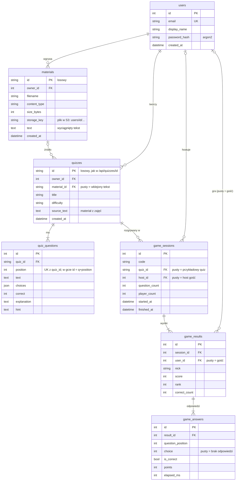

# Qui — Backend

## Start

```bash
cd Backend
python3 -m venv .venv && source .venv/bin/activate
pip install -r requirements.txt
cp .env.example .env
uvicorn app.main:app --reload --host 0.0.0.0 --port 8000
pytest -q
```

Dokumentacja API (Swagger): http://localhost:8000/docs

**Telefony:** `localhost` nie działa z telefonu. Telefon musi być w tej samej sieci Wi-Fi, a frontend łączy się z backendem
przez IP laptopa (`ipconfig getifaddr en0` na macOS), np. `ws://192.168.1.20:8000`. W `.env` ustaw
`FRONTEND_URL=http://<IP>:5173`, żeby `join_url` (do kodu QR) prowadził pod adres osiągalny z telefonu.

## REST

| Metoda | Ścieżka | Odpowiedź |
|---|---|---|
| `POST` | `/api/parties` | `201 { code, host_token, join_url }`. Body opcjonalne: `{ quiz_id?, max_players? }` (bez `quiz_id` przykładowy quiz; `max_players` ≤ `MAX_PLAYERS` z serwera, inaczej `422`). Token logowania opcjonalny — z nim gra trafia do historii hosta |
| `GET` | `/api/parties/{code}` | `{ code, title, state, joinable, player_count, max_players, players: [{ nick, connected }], question_count, current_question, host_connected }` lub `404` — np. dla strony dołączania po zeskanowaniu QR |

## WebSocket

- Host: `ws://<backend>/ws/party/{code}/host?token=<host_token>`
- Gracz: `ws://<backend>/ws/party/{code}/player?nick=<nick>`
- Gracz po zerwaniu połączenia: `ws://<backend>/ws/party/{code}/player?reconnect_token=<token>` — zachowuje punkty
- Zalogowany gracz: dodaj `&access_token=<token z logowania>` — wynik trafi do jego historii i powtórek. Z tym samym tokenem wraca na swoje miejsce także z innego urządzenia. Zły token → `error` + zamknięcie `4401`

Każda wiadomość: `{ "type": "...", "data": { ... } }`.

### Klient → serwer

| type | kto | data |
|---|---|---|
| `start_game` | host | — |
| `next_question` | host | — (w trakcie pytania: kończy je od razu; po odsłonięciu: następne pytanie / koniec) |
| `kick_player` | host | `{ player_id }` |
| `answer` | gracz | `{ question_id, choice }` (`choice` = indeks odpowiedzi) |

### Serwer → klient

| type | do kogo | data |
|---|---|---|
| `host_joined` | host | `{ code, state, joinable, player_count, question_count }` |
| `joined` | gracz | `{ player_id, nick, reconnect_token, score, state }` — zapisz `reconnect_token` w `localStorage` |
| `lobby_update` | wszyscy | `{ players: [{ id, nick, score, connected }] }` |
| `question` | wszyscy | `{ question_id, index, total, text, choices, time_limit, time_left }` |
| `answer_ack` | gracz | `{ question_id }` |
| `answer_count` | host | `{ answered, total }` |
| `reveal` | host | `{ question_id, correct, explanation, hint, choice_counts, is_last, leaderboard }` |
| `reveal` | gracz | jak wyżej + `{ your_answer, your_points, score, streak, rank }`, `leaderboard` = top 5 |
| `game_over` | wszyscy | `{ podium, leaderboard, weakest_questions: [{ question_id, text, correct_answer, hint, correct_ratio }] }` |
| `kicked` | gracz | — |
| `error` | jeden klient | `{ message, request? }` |

Kody zamknięcia: `4400` zły nick / gra już trwa / party pełne, `4401` zły token hosta, `4403` wyrzucony,
`4404` brak party, `4408` party wygasło (sprzątanie), `4409` to samo konto połączyło się z innego urządzenia.

**Powrót po rozłączeniu:** po ponownym połączeniu (`reconnect_token` albo `access_token`) gracz dostaje bieżący ekran:
otwarte pytanie (albo `answer_ack`, jeśli już odpowiedział), swój `reveal` lub `game_over`. Host — to samo.

**Sprzątanie party:** party żyją w pamięci i są usuwane automatycznie (sprawdzanie co minutę):
po 15 min, gdy nikt nie jest połączony; 30 min po końcu gry; zawsze po 6 h. Czasy w `.env`:
`PARTY_IDLE_TTL`, `PARTY_FINISHED_TTL`, `PARTY_MAX_AGE` (sekundy).

## Moduł AI (Marvin): `app/quiz/`

| Metoda | Ścieżka | Body | Odpowiedź |
|---|---|---|---|
| `POST` | `/api/quizzes/generate` 🔒 | `{ text` **albo** `material_id, count=5 (1–20), difficulty="medium" (easy/medium/hard), time_limit=20, title? }` | `201 { id, title, questions: [Question] }`, `401` niezalogowany, `422` złe dane, `502` AI nie dało poprawnego quizu |
| `GET` | `/api/quizzes/{id}` | — | `{ id, title, questions }` lub `404` |
| `POST` | `/api/parties` | `{ quiz_id }` | party z wygenerowanym quizem (bez `quiz_id` → przykładowy quiz z `sample.py`) |

Pytanie = `app/quiz/schemas.py::Question`: `{ id, text, choices[2..4], correct, explanation, hint, time_limit }`.

Jak to działa (`app/quiz/generator.py::generate_questions`): tekst → prompt (`prompts.py`) → LLM →
walidacja Pydantic (`ai_schemas.py::AIQuiz`: 4 różne odpowiedzi, `correct_index` 0–3, bez duplikatów,
dokładnie `count` pytań) → losowanie kolejności odpowiedzi → `Question`. Zły JSON od modelu jest
ponawiany (`LLM_MAX_ATTEMPTS`, domyślnie 3). Quizy zapisują się w bazie (`store.py`) razem z materiałem i właścicielem.

Dostawca AI: dowolne API zgodne z OpenAI, ustawiane w `.env` (`LLM_BASE_URL`, `LLM_API_KEY`, `LLM_MODEL`,
`LLM_RESPONSE_FORMAT`) — domyślnie GroqCloud `openai/gpt-oss-120b`, przykład dla NVIDIA w `.env.example`.

## Materiały

| Metoda | Ścieżka | Body | Odpowiedź |
|---|---|---|---|
| `POST` | `/api/materials` 🔒 | `multipart/form-data`, pole `file` (`.txt`, `.md`; maks. 5 MB) | `201 { id, filename, size_bytes, char_count, preview, created_at }`, `413` za duży, `422` zły format / pusty |
| `GET` | `/api/materials` 🔒 | — | moje materiały (jak wyżej) |
| `GET` | `/api/materials/{id}` 🔒 | — | jeden materiał; cudzy → `404` |
| `GET` | `/api/materials/{id}/download` 🔒 | — | `{ url, expires_in }` — link do oryginalnego pliku, ważny 10 min; cudzy → `404` |
| `DELETE` | `/api/materials/{id}` 🔒 | — | `204`; usuwa materiał i plik, quizy z niego zostają |

Tekst jest wyciągany od razu przy wgraniu i zapisywany w bazie, a oryginalny plik trafia do Neon Storage (S3)
do katalogu właściciela: `users/<user_id>/materials/<material_id>/<plik>`. Każdy widzi i pobiera tylko swoje pliki.
Bez `S3_BUCKET` zapisuje się sam tekst (`has_file: false`). Kodowanie: UTF-8 albo Windows-1250.
Nowy format = jedna funkcja w `app/materials/extract.py::EXTRACTORS` (PDF i DOCX — moduł AI).
Quiz z materiału: `POST /api/quizzes/generate` z `{ "material_id": "..." }`; tytuł domyślnie = nazwa pliku.

## Logowanie i użytkownicy

🔒 = wymaga nagłówka `Authorization: Bearer <access_token>`.

| Metoda | Ścieżka | Body | Odpowiedź |
|---|---|---|---|
| `POST` | `/api/auth/register` | JSON `{ email, password (8–128), display_name (1–40) }` | `201 { access_token, token_type, user }`, `409` email zajęty, `422` złe dane |
| `POST` | `/api/auth/login` | **formularz** (`application/x-www-form-urlencoded`): `username=<email>&password=<hasło>` | `{ access_token, token_type, user }`, `401` zły email lub hasło |
| `GET` | `/api/auth/me` 🔒 | — | `{ id, email, display_name, created_at }` |
| `GET` | `/api/users/me/quizzes` 🔒 | — | moje quizy: `[{ id, title, difficulty, question_count, created_at }]` |
| `GET` | `/api/users/me/games?limit=20` 🔒 | — | gry, w których grałem: `[{ session_id, quiz_id, quiz_title, played_at, nick, score, rank, player_count, correct_count, question_count }]` |
| `GET` | `/api/users/me/review?limit=20` 🔒 | — | do powtórki — pytania, na które odpowiedziałem źle: `[{ quiz_id, quiz_title, question, correct_answer, your_answer, explanation, hint, times_wrong }]` |

- Token ważny 7 dni (`ACCESS_TOKEN_EXPIRE_MINUTES`). Frontend trzyma go np. w `localStorage` i dokleja do zapytań.
- Granie dalej działa **bez konta** (sam nick przez QR). Konto daje historię i powtórki; generowanie quizu wymaga konta, żeby nikt obcy nie zużywał limitu klucza AI.
- W `/docs` kliknij **Authorize**, wpisz email jako `username` i hasło — Swagger sam doklei token.

Przykład dla frontendu:

```js
const res = await fetch(`${API_URL}/api/auth/login`, {
  method: "POST",
  body: new URLSearchParams({ username: email, password }),
});
const { access_token, user } = await res.json();
await fetch(`${API_URL}/api/quizzes/generate`, {
  method: "POST",
  headers: { "Content-Type": "application/json", Authorization: `Bearer ${access_token}` },
  body: JSON.stringify({ text, count: 5 }),
});
```

## Baza danych

SQLModel (SQLAlchemy). Lokalnie plik SQLite `qui.db`, na produkcji PostgreSQL przez `DATABASE_URL`. Tabele tworzą się
same przy starcie serwera (`app/models.py`).



- Trwające gry (party) dalej żyją w pamięci serwera. Do bazy zapisuje się gra **po zakończeniu**: sesja, wynik
  każdego gracza i każda odpowiedź — z tego powstaje historia i lista powtórek.
- **Produkcja: Neon.** Darmowy dysk Render jest kasowany przy każdym deployu, restarcie i uśpieniu (SQLite tam nie
  przetrwa), a darmowy PostgreSQL na Render jest usuwany po 30 dniach. Dlatego baza i pliki są w Neon:
  `DATABASE_URL` (adres **bez** `-pooler` — backend ma własną pulę połączeń) i `S3_BUCKET` + `AWS_*` w panelu Render.
  Neon usypia bazę po kilku minutach bez ruchu; pierwsze zapytanie po przerwie trwa ok. 1–4 s.
- **Zmiany schematu:** `create_all` tylko dodaje brakujące tabele, nie zmienia istniejących. Dopóki nie mamy danych do
  zachowania, przy zmianie kolumn wystarczy wyczyścić bazę; potem trzeba dodać migracje (Alembic).

